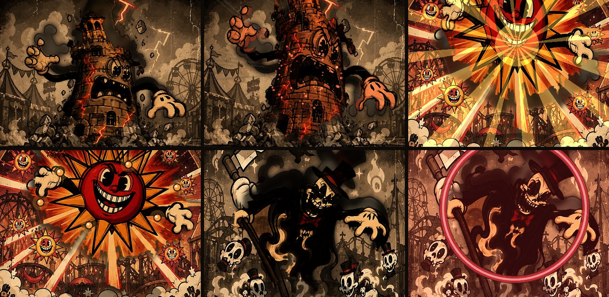

# Die Bühne – Bosse einbauen, bewegen, vertonen

Über dem Kartentisch steht die Bühne: dein Bühnenbild, davor die Figur.
Die Figur ist **ein einziges gemaltes Bild**. Sie wird nicht in Gelenke
zerlegt, sondern verformt, so wie eine Gummischlauch-Figur der Fleischer-Zeit:

- Die Füße bleiben stehen. Der Oberkörper biegt sich, eine Welle läuft durch
  den Körper, die Mitte bläht sich auf, und die Linien „kochen“ leicht wie
  bei handgezeichnetem Trickfilm. Das macht `shader/figur.gdshader`.
- Lage, Drehung, Stauchung, Biegung, Beule und Welle hängen an leicht
  unterdämpften **Federn**. Eine Bewegung setzt nur Ziele, die Federn
  machen daraus fließende Übergänge mit Nachschwingen
  (`addons/tartot_karten/buehne.gd`).
- In Ruhe **hopst, schwebt oder wiegt** sich die Figur, und zwar im Takt der
  Musik (`KartenKlang.schlaege()`).
- Jeder Angriff folgt dem Dreiklang des Zeichentricks:
  1. **Ausholen:** stauchen, zurücklehnen, Lotterpfeife.
  2. **Schlag:** strecken, nach vorn, Effekt und Klang.
  3. **Nachschwingen:** zurückfedern.



*Turm: Blitzschlag, Phase 2 · Rote Sonne: Strahlen, kreisende Sonnen ·
Tod: Sense, Phase 2.*

`demo/buehnen.tscn` zeigt alle Bosse nacheinander. Jeder tritt auf, zeigt
jeden Angriff, wird getroffen, geht in Phase 2 und fällt.

```sh
godot --path godot-karten res://demo/buehnen.tscn
godot --path godot-karten res://demo/buehnen.tscn -- --boss=boss_turm,boss_sonne
```

## Einen neuen Boss einbauen

### Weg A – getrennte Ebenen (empfohlen)

Male oder exportiere Figur und Hintergrund als **zwei Bilder**. Das gibt die
beste Qualität, und es muss nichts freigestellt werden. Lege diese Dateien ab:

```
godot-karten/buehnen/boss_<name>/
  hintergrund.jpg   Bühnenbild ohne Figur, etwa 1000 × 800 (wird eingepasst; .png geht auch)
  figur.png         nur die Figur, mit Transparenz, eng beschnitten
  figur.json        wo die Figur im Bühnenbild steht (siehe unten)
  platz_0..2.png    drei Bilder für Vergangenheit, Gegenwart, Zukunft (200 × 240)
```

`figur.json` gibt alle Werte in Pixeln des Bühnenbilds an:

```json
{ "buehne": [1000, 809],
  "figur": [x, y, breite, hoehe],
  "fuss": [x, y],
  "schwerpunkt": [x, y] }
```

- `figur`: das Rechteck, in dem `figur.png` sitzt.
- `fuss`: der Punkt, an dem die Figur steht. Er ist der Drehpunkt für
  Biegen und Hopsen.
- `schwerpunkt`: die Mitte des Körpers. Dort sitzt die Beule, und von dort
  starten die Effekte.

### Weg B – aus deinem Boss-Blatt schneiden

So sind die 13 Bosse entstanden. Das Blatt kommt nach
`assets/bossblaetter/<name>.jpg`. Danach trägst du in
`tools/buehne/zerlegen.py` unter `BOSSE` ein:

- den Ausschnitt der Bühne,
- die drei Platzbilder,
- einige Punkte **auf** der Figur (`pos`) und **neben** ihr (`neg`).

Alle Werte sind Koordinaten des Blatts. Dann:

```sh
python3 -m venv .venv && .venv/bin/pip install numpy pillow opencv-python-headless "rembg[cpu]"
.venv/bin/python tools/buehne/zerlegen.py boss_<name>
```

Segment Anything stellt die Figur frei. Hinter ihr bleibt ein weicher
Schattenriss im Bühnenbild stehen. Bewegt sich die Figur weit, sieht man dort
einen Schatten und kein Loch.

### Choreografie

Wie sich der Boss bewegt und angreift, steht in
`addons/tartot_karten/choreografie.gd`:

```gdscript
"boss_<name>": {
	"art": "stampfen",              # stampfen | schweben | wiegen
	"farbe": Color("F4D27A"), "zweite": Color("E0543A"),
	"angriffe": {
		"attack":  ["ausfall", "blitz", "blitz"],     # [Bewegung, Effekt, Klang]
		"attack1": ["sprung", "steine", "steine"],
		"summon":  ["recken", "helfer", "beschwoeren"],
	},
},
```

Die Schlüssel (`attack`, `attack1`–`attack3`, `summon`, `supernova`) sind die
Hinweise, die der Regelkern pro Zug liefert (`AnimationCues` in C#).
Fehlt ein Hinweis, gilt `attack`.

| Bewegung | Was passiert |
|---|---|
| `ausfall` | ausholen, nach vorn schnellen |
| `sprung` | in die Knie, hoch, aufstampfen (Rauch, Wackeln) |
| `drehung` | einmal um sich selbst, Schlag mitten in der Drehung |
| `recken` | aufrichten, aufblähen, leuchten |
| `ansturm` | auf die Kamera zu, Tempolinien |
| `wirbel` | Zittern und Wanken |
| `bruellen` | aufblähen, Bildschirm bebt |

| Effekt | Bild |
|---|---|
| `blitz` | gezackter Blitz mit Verzweigungen |
| `steine` | Steinregen und Staub |
| `strahlen` | drehende Strahlen |
| `wasser` | rollende Welle |
| `feuer` | Feuerringe |
| `mischen` | Welle und Feuerringe |
| `tropfen` | Tropfenregen |
| `segen` | Strahlen und Kugeln |
| `saeulen` | Lichtsäulen |
| `helfer` | Abbilder springen aus dem Boden |
| `geister` | wie `helfer`, als helle Schatten |
| `wuerfel`, `karten`, `sterne` | regnen dem Spieler entgegen |
| `kette` | Kette schnellt vor |
| `nebel`, `schleier` | dunkle Welle, Schleierbahn |
| `orakel`, `sonnen` | Kugeln kreisen und fliegen |
| `sense`, `schwert`, `zauberstab`, `peitsche`, `radschwung`, `hieb` | Sicheln und Bögen |
| `muenzen`, `fruechte` | Münz- und Fruchtregen |
| `ranken`, `bluete` | wachsende Ranken, Blütenstrahlen |
| `ansturm`, `funken` | Tempolinien, Funkenring |

Klänge heißen `klang/angriff_<klang>.wav`. Die mitgelieferten sind:

- steine, blitz, segen, chor, wasser, feuer, wuerfel, kette, orakel
- schleier, strahlen, rotation, rad, sense, geister, zauber, schwert
- muenzen, ranken, fruechte, galopp, peitsche, bruellen
- beschwoeren, supernova
- attack, frenzy, drain, hex, guard

Eigene Aufnahmen mit gleichem Namen ersetzen sie.

## Klang, Musik, Haptik

- `tools/klang/klaenge.py` erzeugt 74 Klänge:
  - Karten-Foley: Blatt, Körper, Raum, dazu Riffle-Mischen.
  - Die Angriffe oben.
  - Zeichentrick-Foley: Lotterpfeife beim Ausholen, Boing beim Sprung,
    Beckenwirbel und Tusch beim Auftritt, Gong und Gebrüll in Phase 2,
    absteigende Pfeife und Krach beim Tod.
- `tools/klang/musik.py` erzeugt einen Jahrmarkts-Walzer, gespielt auf
  Dampforgel, Tuba und Glockenspiel:
  - a-Moll, 3/4, 138 Schläge pro Minute.
  - Darüber liegt eine Bossschicht aus Pauke, Posaunen und
    Streichertremolo. Sie wird im Bosskampf eingeblendet.
  - Alles klingt durch ein Grammophon (Bandbreite, Wow, Knistern).
  - Dazu kommen der Sieg-Tusch und das Wah-wah-wah-waaah der Niederlage.
- `KartenKlang.fuehlen(ms, staerke)` lässt das Handy vibrieren:
  - beim Nehmen, Ablegen und Wählen,
  - bei jedem Zählschritt,
  - bei jedem ×-Faktor,
  - beim tödlichen Treffer,
  - wenn ein Angriff dich trifft.

  Auf Android muss im Export die Berechtigung **VIBRATE** gesetzt sein.

## Projektor

`shader/projektor.gdshader` liegt über allem und erzeugt:

- Bildstand-Zittern mit 24 Bildern pro Sekunde
- Flackern
- rotgoldene Halation um helle Stellen
- Korn, Staub und gelegentliche Kratzer
- eine Vignette
- einen roten Rand, wenn du getroffen wirst
- die Irisblende beim Szenenwechsel

Alles ist zurückhaltend eingestellt. Die Stärke regeln die Uniforms `korn`,
`halation`, `vignette` und `kratzer`.
