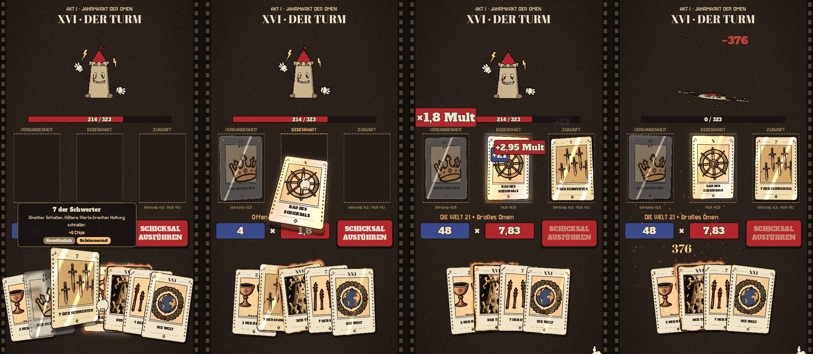
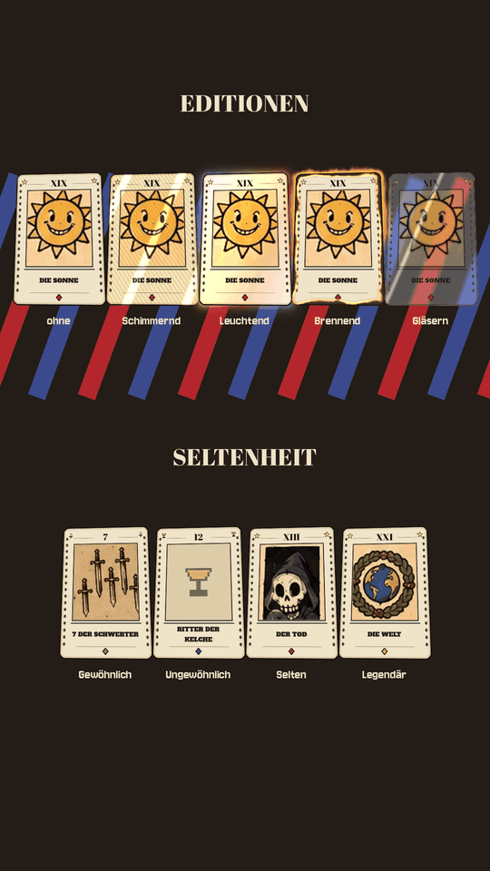

# Tartot Kartentisch (Godot 4.4)

Der Kampftisch von TARTOT, aufgebaut wie die Boss-Blätter: Kopfleiste mit
Akt, Gegner und Runde, darunter die **Bühne** mit dem gemalten Boss, die drei
Legeplätze, die Hand und die Fußleiste mit **Schicksal ausführen**. Die
Karten bewegen sich wie bei Balatro, die Figuren wie Gummischlauch-Puppen
der Fleischer-Zeit, dazu Musik, Foley, Vibration und ein Projektorfilter.
Wie Bühne und Bosse funktionieren und wie du neue einbaust: [`BUEHNE.md`](BUEHNE.md).
**Godot 4.4 .NET · GDScript + C#-Regelkern · GL Compatibility · Hochformat 1080 × 1920** — also
dieselben Einstellungen wie der Godot-Port auf `chatgpt/godot-celluloid-port`.



*Drüberfahren mit Info · Ziehen mit Schwung · Kaskade bis ×1,8 · tödlich,
die Glaskarte zerspringt.*



## Regelkern in Godot

Der Kartentisch rechnet nichts selbst. `kern/TartotKern.cs` (Autoload
`Kern`) verbindet GDScript mit dem C#-Regelkern. `TartotKartentisch.csproj`
verlinkt die Quellen aus `unity/Assets/Tartot/Core`: Unity, Godot, Tests und
Simulation nutzen also eine einzige Kopie der Regeln.

| Aufruf | Liefert |
|---|---|
| `NeuerRun(saat)` | startet einen Run, der erste Kampf steht bereit |
| `Kampf()` | Gegner (Leben, Haltung, Absicht, Sprite), Spieler, Hand, Plätze, gesperrter Platz |
| `Legen(instanz, platz)`, `Zuruecknehmen(platz)`, `Abraeumen()` | legt Karten in den Kern |
| `Vorschau()` | Chips, Mult, Wert, Muster, Beinahe-Hinweise, tödlich? |
| `Ausfuehren()` | Wertungsschritte für die Kaskade, angekommener Schaden, Gegner-Animationen, Sieg/Niederlage, zersprungene Karten |
| `Vorschlag()` | die beste Legung laut Autopilot |
| `Weiter()` | nach dem Sieg bis zum nächsten Kampf (Belohnung, Weg, Laden entscheidet vorerst der Autopilot) |

Nötig ist **Godot 4.4 mit .NET** und das .NET-8-SDK. Ohne .NET zeigt der
Tisch einen Hinweis; die Galerie läuft auch ohne.

## Klang

Musik, Angriffsklänge und Zeichentrick-Foley stehen in [`BUEHNE.md`](BUEHNE.md).

`addons/tartot_karten/klang.gd` (`KartenKlang`) spielt prozedural
erzeugte Klänge (`tools/klang/klaenge.py`, nur numpy). Sie sind wie Foley
gebaut, in drei Schichten: das **Blatt** (gefilterter Kartonschnapp mit
Resonanz), der **Körper** (Hand, Filz, Tisch) und der **Raum** (kurzer
Faltungshall).

- **Mischen:** ein echtes Riffle. 52 Blätter schnappen erst schnell, dann
  langsamer ineinander, danach fällt die Brücke zurück, und der Stapel
  klopft zweimal auf den Tisch. Das volle Riffle kommt zu Kampfbeginn, ein
  halbes, wenn die Ablage nachgemischt wird.
- **Karten:** Nehmen, Ablegen, Austeilen, Umdrehen, Drüberfahren und Wählen
  gibt es in 2 bis 4 Varianten. `KartenKlang` wählt zufällig und nie
  dieselbe zweimal hintereinander.
- **Angriffe nach Absicht:**

  | Absicht | Klang |
  |---|---|
  | Angriff | Hieb durch die Luft, dann Aufprall |
  | Raserei | drei schnelle Hiebe, der letzte am härtesten |
  | Aussaugen | feuchtes Schlürfen, das nach unten zieht, Herzschlag |
  | Fluch | Tritonus-Chor, der anschwillt, dazu Flüstern |
  | Abwehr | Holzschild |

  Beschwören und Supernova haben eigene Klänge. Bosse klingen tiefer und
  schwerer. Getroffene Gegner und du selbst habt eigene Treffer-Klänge,
  deren Wucht mit dem Schaden wächst.
- **Kaskade:** eine Spieluhr, die je Schritt einen Halbton steigt (höchstens
  eine Oktave), dazu ein Paukenschlag mit Blech bei jedem ×-Faktor und ein
  Arpeggio mit Gong beim tödlichen Treffer.
- **Editionen:** Glas zerspringt und rieselt, Feuer faucht und knackt, der
  Schimmer glitzert. Darunter liegt leises Projektorrattern als Schleife.

Die Klänge liegen als unkomprimiertes PCM vor (`compress/mode=0` in den
`.import`-Dateien). Eigene Aufnahmen mit gleichem Dateinamen ersetzen die
erzeugten. Varianten heißen `name_1.wav`, `name_2.wav` und so weiter.

## Starten

```sh
godot --path godot-karten                 # Kartentisch zum Selberspielen
godot --path godot-karten res://demo/galerie.tscn   # alle Editionen und Seltenheiten
godot --path godot-karten res://demo/buehnen.tscn   # alle Bosse: Auftritt, Angriffe, Phase 2, Tod
godot --path godot-karten -- --gegner=boss_sonne    # Kampftisch gegen einen bestimmten Gegner
```

Karten antippen (wählen) oder auf **Vergangenheit**, **Gegenwart**,
**Zukunft** ziehen, dann **Schicksal ausführen**. Maus und Touch gehen beide.

Aufnehmen ohne Bildschirm (so sind die Bilder oben entstanden):

```sh
xvfb-run -a -s "-screen 0 1080x1920x24" \
  godot --path godot-karten --write-movie film/f.png --fixed-fps 30 -- --autoplay
ffmpeg -framerate 30 -i film/f%08d.png -c:v libx264 -pix_fmt yuv420p kartentisch.mp4
```

Mit `--autoplay` führt ein Handschuh die Szene selbst vor und beendet sie.

## Was drin ist

```
addons/tartot_karten/
  karte.gd          TarotKarte   Karte aus der Vorlage, Federbewegung, Neigung, Umdrehen, Auflösen
  tisch.gd          KartenTisch  Hand als Fächer, Schweben, Wählen, Ziehen, Plätze, Einsortieren
  platz.gd          KartenPlatz  Legeplatz im Filmrahmen (auch „eingestürzt“ für den Turm)
  info.gd           KartenInfo   Info-Fenster mit Seltenheits- und Editions-Pille
  kaskade.gd        WertungsKaskade  Chips × Mult, Karte für Karte, Faktoren zuletzt
  karten_daten.gd   KartenDaten  liest daten/karten.json (aus dem Spielkern exportiert)
  klang.gd          KartenKlang  Klänge, Musik mit Takt, Tonleiter der Kaskade, Vibration
  buehne.gd         BossBuehne   Bühnenbild, Figur an Federn, Angriffe, Phase 2, Tod
  choreografie.gd   Choreografie Ruhebewegung und Angriffe je Boss
  effekte.gd        BuehnenEffekte  Blitz, Strahlen, Welle, Feuerringe, Säulen, Hiebe, Regen, Rauch …
  stil.gd           TarotStil    Farben, Schriften, Zierplatten, Knöpfe
  handschuh.gd      Zeigehand für Vorführungen
  shader/           Karte (Neigung, Editionen, Papierlicht), Glas, Figur (Verformung), Projektor
  kunst/            Rahmen, Rückseite, Motive, Bedienelemente (ui/), Vorlage
  klang/            78 Klänge und Musik (aus tools/klang)
  schrift/          IM Fell DW Pica (Titel, Text), Oranienbaum (Zahlen), OFL
  VORLAGE.md        Karten selbst malen: Maße, Dateinamen, Stellschrauben
buehnen/<boss>/     Bühnenbild, Figur, Platzbilder je Boss (aus tools/buehne/zerlegen.py)
demo/               Kampftisch, Bühnen-Galerie, Karten-Galerie
```

### Bewegung wie bei Balatro

- Jede Karte hängt an einer **leicht unterdämpften Feder**: sie schießt über
  ihr Ziel hinaus und schwingt ein.
- Beim Ziehen **legt sie sich in die Bewegung** und kippt nach
  der Geschwindigkeit.
- Unter dem Zeiger **hebt sie sich** und kippt ihm entgegen (Fake-3D im
  Shader). Die Nachbarn weichen aus.
- Im Stillstand **wiegt** sie sich leise.
- **Stoß** beim Zählen, Einrasten und Wählen: ein kurzer Ausschlag, der
  nachfedert.
- Der **Schatten** fällt weiter, je höher die Karte schwebt.
- Die Hand ist ein **Fächer**, der enger wird, je mehr Karten sie hat.
  Beim Zurückziehen öffnet sich eine Lücke, wo die Karte landen wird.
- **Austeilen** wie ein Croupier: erst fliegen, dann aufdecken.

### Seltenheit und Editionen

Wie die Karten aussehen und was die Editionen im Spiel tun, steht in
[`addons/tartot_karten/VORLAGE.md`](addons/tartot_karten/VORLAGE.md). Kurz:

- Die Seltenheit steht als Raute auf der Karte und als Pille im Info-Fenster.
  Legendäre Karten tragen zusätzlich einen goldenen Glanz.
- Die Editionen sind schimmernd, leuchtend, brennend und gläsern. Gläsern ist
  echte Glasmorphism: der Tisch dahinter wird weichgezeichnet.

### Kaskade

`WertungsKaskade.abspielen(schritte, karten, gegner_lp)` spielt die
Wertungsschritte ab, die der Kern schon liefert
(`ScoreBreakdown.Steps` in C#).

1. Jede Karte springt an und wirft ihre Chips und ihren Mult
   in die Kästen. Das Tempo zieht dabei an.
2. Dann folgen die Muster.
3. Zuletzt kommen die ×-Faktoren mit Bildschirmwackeln.
4. Die Summe zählt hoch. Ist sie tödlich, wird sie golden und sprüht Funken.

## In den Godot-Port übernehmen

Das Addon kennt keine Spielregeln, nur Karten-IDs, Editionen und
Wertungsschritte. Übernehmen:

1. `addons/tartot_karten/` nach `godot/addons/tartot_karten/` kopieren.
2. Für Karten `TarotKarte.erzeugen(id, edition)` benutzen und für die Hand
   einen `KartenTisch` mit drei `KartenPlatz`-Knoten.
3. Den Autoload `Kern` (`kern/TartotKern.cs`) und die Kern-Verlinkung aus
   `TartotKartentisch.csproj` übernehmen. `demo/demo.gd` zeigt, wie Tisch,
   Kaskade und Kern zusammenspielen.

## Daten

`addons/tartot_karten/daten/karten.json` ist ein Export aus dem Spielkern.
Er enthält alle 78 Karten, die Seltenheiten und die Editionen. Nach
Regeländerungen neu erzeugen:

```sh
dotnet run --project src/Tartot.Sim -- --export-cards=godot-karten/addons/tartot_karten/daten/karten.json
```

## Grenzen

- 27 der 78 Karten haben ein Motiv, ausgeschnitten aus deinen Boss-Blättern.
  Zahlenkarten ohne eigenes Motiv zeigen das Motiv derselben Farbe mit dem
  nächsten Rang, große Arkana ohne Motiv das Sinnbild der Rückseite.
- Die Figuren sind aus den Blättern freigestellt (Segment Anything). Kanten
  sind dort am saubersten, wo die Figur eine Tintenkontur hat; getrennte
  Ebenen (siehe BUEHNE.md) sind besser.
- Normale Gegner ohne gemalte Figur stehen als Blockout-Animation vor dem
  Bühnenbild des Akts.
- Magier, Hohepriesterin, Herrscherin, Wagen und Kraft haben Bühne und
  Choreografie, sind aber noch keine Bosse im Regelkern (Regeln fehlen).
- Für Belohnung, Wegwahl, Laden und Ereignisse gibt es am Tisch noch
  keine Oberfläche. Nach einem Sieg entscheidet dort der Autopilot.
- Die Demo gibt der ersten Hand je eine Edition (Vorführdeck).
- Geprüft ist das Addon unter Linux mit Software-Rendering
  (llvmpipe, GL Compatibility). Auf Geräten fehlt die Prüfung noch.
