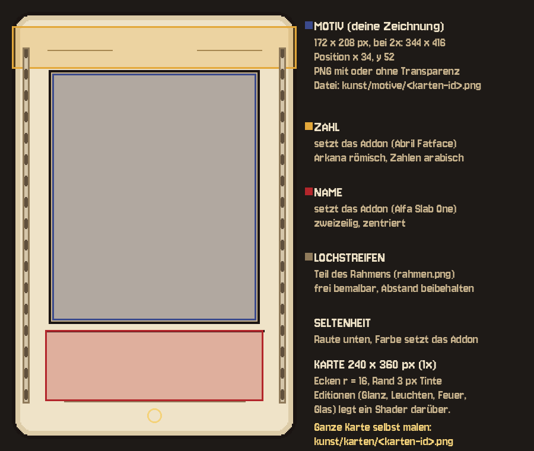

# Karten selbst gestalten

Die Karte folgt deinem Entwurf: Pergament, Lochstreifen links und rechts wie
ein Filmstreifen, oben die Zahl, in der Mitte das Motiv, unten der Name. Das
Addon setzt sie aus Einzelteilen zusammen — du malst nur, was du ändern
willst. Glanz, Leuchten, Feuer, Glas und die Neigung kommen aus dem Shader,
die musst du nicht malen.



## Zwei Wege

| Weg | Du malst | Das Addon setzt dazu |
|---|---|---|
| **A · nur das Motiv** | `kunst/motive/<karten-id>.png` (172 × 208) | Rahmen, Zahl, Name, Farbsymbole, Seltenheit |
| **B · die ganze Karte** | `kunst/karten/<karten-id>.png` (240 × 360) | nur die Seltenheitsraute |

Weg A ist der schnelle: 78 Motive, alles andere bleibt einheitlich und die
Namen bleiben übersetzbar. Weg B für Karten, die aus der Reihe fallen sollen
(Der Narr, Die Welt, Bosskarten). Beides lässt sich mischen; liegt für eine
Karte eine ganze Karte vor, gewinnt sie.

Fehlt ein Motiv, zeigt die Karte das große Farbsymbol als Platzhalter — das
Spiel läuft also auch mit halb fertiger Kunst.

## Maße

Alle Maße in Pixeln bei 1× (so groß liegt die Karte im Spiel, bevor sie
skaliert wird). Die Vorlage `kunst/vorlage_2x.png` zeigt sie doppelt so groß.

| Teil | Position | Größe | Datei |
|---|---|---|---|
| Karte | — | 240 × 360, Ecken r = 16, Rand 3 px Tinte | `kunst/rahmen.png` |
| Motiv | x 34, y 52 | 172 × 208 | `kunst/motive/<id>.png` |
| Zahl | x 0, y 12 | 240 × 36 (zentriert) | setzt das Addon |
| Name | x 28, y 268 | 184 × 60 (zweizeilig, zentriert) | setzt das Addon |
| Farbsymbole | x 14 und x 210, y 16 | 16 × 16 | `kunst/farben/<farbe>.png` |
| Lochstreifen | x 9 und x 225 | Loch 6 × 9, Abstand 18 | Teil von `rahmen.png` |
| Seltenheit | Mitte x 120, y 340 | Raute 14 × 16 | setzt das Addon |
| Rückseite | — | 240 × 360 | `kunst/rueckseite.png` |

Bei Weg B: halte die Stelle der Raute (unten Mitte, etwa 20 × 20 um x 120,
y 340) ruhig, sonst beißt sie sich mit deiner Zeichnung.

**Pixel:** Die Vorderseite wird ohne Glättung gezeichnet. Male am besten in
1×. Wer lieber in 2× malt (344 × 416 fürs Motiv, 480 × 720 für die ganze
Karte), malt in 2 × 2-Blöcken — das Addon verkleinert auf 1× und nimmt jedes
zweite Pixel. Transparenz ist erlaubt; was durchsichtig ist, zeigt den
Rahmen dahinter.

**Farben:** die Palette von „Schicksal auf Zelluloid“ — Tinte `#1A1412`,
Papier `#EFE3C8`, Sepia `#C9B48E`/`#8F7A5A`/`#4E4032`, Gold `#E3A83B`, Blut
`#B3262B`, Indigo `#3B4A8C`. Der Glas-Shader behandelt helles,
ungesättigtes Papier als Glas und lässt Tinte und kräftige Farben stehen:
Wenn dein Motiv auf Glas gut aussehen soll, gib ihm klare Konturen.

## Dateinamen

`<farbe>_<rang>` für die Zahlen- und Hofkarten, `major_<n>` für die großen
Arkana — genau die `id` aus `daten/karten.json`:

| Farbe | ids | Ränge |
|---|---|---|
| Schwerter | `swords_1` … `swords_14` | 1 Ass · 2–10 · 11 Bube · 12 Ritter · 13 Königin · 14 König |
| Kelche | `cups_1` … `cups_14` | |
| Münzen | `pentacles_1` … `pentacles_14` | |
| Stäbe | `wands_1` … `wands_14` | |
| Große Arkana | `major_0` … `major_21` | 0 Der Narr … XXI Die Welt |

Farbsymbole: `schwerter`, `kelche`, `muenzen`, `staebe`, `arkana`.

## Seltenheit — wie bei Balatro, aber aus der Karte selbst

Die Seltenheit hängt an der Karte, nicht am Zufall, und steht an drei
Stellen: als **Raute** unten auf der Karte, als **farbige Pille** im
Info-Fenster beim Drüberfahren und — nur bei Legendär — als **goldener
Glanz**, der über die ganze Karte wandert.

| Stufe | Karten | Farbe |
|---|---|---|
| Gewöhnlich | Zahlenkarten 1–10 | Sepia `#8F7A5A` |
| Ungewöhnlich | Hofkarten | Indigo `#3B4A8C` |
| Selten | große Arkana | Blut `#B3262B` |
| Legendär | Der Narr, Das Rad, Die Welt | Gold `#E3A83B` |

## Editionen — der Shader legt sie über jede Karte

| Edition | Aussehen | Wirkung im Spiel |
|---|---|---|
| Schimmernd | Folienstreifen und feine Linien, die mit der Neigung wandern | +6 Chips |
| Leuchtend | schillernd Indigo → Gold → Glut, pulsierender Schein um die Karte | +0,4 Mult |
| Brennend | verkohlter, glühender Rand, Flammen züngeln über die Kante | ×1,4 Mult, +3 Brand beim Gegner, kostet dich 2 LP |
| Gläsern | durchsichtig, der Tisch dahinter verschwimmt (Glasmorphism), Lichtkante | ×1,8 Mult, zerspringt zu 25 % |

Die Wirkungen kommen aus dem Spielkern (`CardEditions` in
`unity/Assets/Tartot/Core/Model/Editions.cs`) und reisen über
`daten/karten.json` hierher; das Addon zeigt sie nur.

Verdeckte Karten zeigen keine Edition — die Überraschung beim Aufdecken
gehört dazu.

## Stellschrauben

In `karte.gd` (als `@export`, also auch im Inspektor):

| Wert | Standard | Wirkung |
|---|---|---|
| `feder` / `daempfung` | 170 / 14 | wie weich die Karte an ihren Platz federt; weniger Dämpfung = mehr Nachschwingen |
| `feder_gezogen` / `daempfung_gezogen` | 900 / 34 | wie straff sie am Finger hängt |
| `schwung` | 0,0011 | wie weit sie sich beim Ziehen in die Bewegung legt |
| `max_neigung` | 22° | wie stark sie zum Zeiger kippt |

In `tisch.gd`: `hand_breite`, `max_abstand`, `bogen`, `faecher` (Fächerform),
`anheben_schweben`, `anheben_gewaehlt`, `zug_schwelle`.

Im Shader (`shader/karte_basis.gdshaderinc`): `fov` für die Perspektive,
die Editionen stehen in `editionen()` — dort lassen sich Farben und Tempo
von Glanz, Schein und Flammen ändern.

## Neu erzeugen

Rahmen, Rückseite, Farbsymbole und die Vorlage entstehen aus einem Skript;
wer sie lieber von Hand malt, überschreibt einfach die PNGs.

```sh
python3 tools/karten/vorlage.py              # braucht Pillow
```

Den Kartenkatalog (Namen, Zahlen, Texte, Seltenheit, Editionen) erzeugt der
Spielkern:

```sh
dotnet run --project src/Tartot.Sim -- --export-cards=godot-karten/addons/tartot_karten/daten/karten.json
```

Neue PNGs importiert Godot beim Öffnen des Editors selbst (ohne Editor:
`godot --path godot-karten --import`).

## Schriften

Abril Fatface (Zahl), Alfa Slab One (Name, Info-Titel), Jersey 10 (Texte).
Alle drei stehen unter der SIL Open Font License, die Lizenztexte liegen in
`schrift/`.
